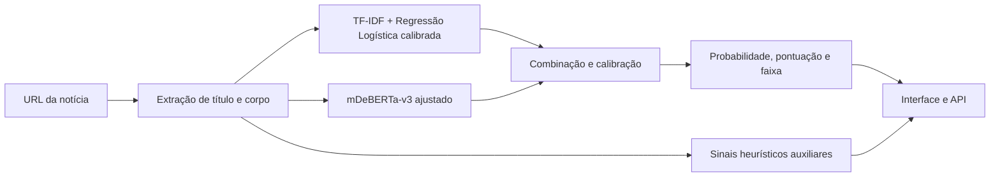

# VerificAI

> Antes de compartilhar, observe os sinais.

A VerificAI recebe a **URL de uma notícia**, extrai seu título e corpo e estima
sua classe usando um classificador textual calibrado e um **mDeBERTa-v3 ajustado
para notícias**, executados localmente.

A interface apresenta probabilidades, uma pontuação de confiabilidade, as faixas
**provavelmente verdadeira**, **inconclusiva** ou **possível desinformação**,
trechos que influenciaram a previsão final e cinco sinais heurísticos auxiliares.

**A aplicação analisa padrões textuais; não confirma alegações em fontes
independentes.** Os modelos são experimentais e podem errar. Os sinais auxiliares
não alteram a probabilidade do ensemble.

## Testar localmente com o modelo NLP

Não é necessário treinar, instalar Node.js ou configurar uma conta Hugging Face.
O Flask serve a interface e os pesos treinados são distribuídos por **Git LFS**.

### Pré-requisitos

- Git e [Git LFS](https://git-lfs.com/).
- Python **3.14**; ambiente validado: **3.14.6 no macOS arm64**.
- Espaço para o bundle de aproximadamente **1,06 GiB**, sua cópia no cache do
  Git LFS e o ambiente Python. Reserve vários GB livres.
- Internet para clonar, instalar dependências e acessar as notícias. A inferência
  usa os pesos locais, sem consultar o Hugging Face.

GPU é opcional. `TRANSFORMER_DEVICE=auto` escolhe CUDA, MPS ou CPU. A latência em
CPU depende do equipamento. A instalação em outros sistemas depende das wheels
compatíveis com as versões indicadas; Windows/Linux ainda não foram validados.

### 1. Instalar Git LFS e clonar

No macOS com Homebrew: `brew install git-lfs`. Para Windows/Linux, consulte a
[instalação oficial](https://docs.github.com/en/repositories/working-with-files/managing-large-files/installing-git-large-file-storage).

```bash
git lfs install
git clone https://github.com/alvezclari/verificAI.git
cd verificAI
git lfs pull
```

A versão atual é publicada em `main` e `modularization`. Um clone comum usa
`main`. Prefira clonar com Git: o botão **Download ZIP** pode fornecer apenas os
ponteiros LFS. O download dos pesos está
sujeito às cotas LFS do proprietário. Veja o
[funcionamento do LFS](https://docs.github.com/en/repositories/working-with-files/managing-large-files/about-git-large-file-storage).

### 2. Preparar o ambiente

macOS/Linux:

```bash
python3.14 -m venv .venv-classificador
source .venv-classificador/bin/activate
python -m pip install -r requirements-inference.txt
python -m pip check
python scripts/check_model.py --verify-hashes
python scripts/smoke_test.py
```

Windows PowerShell:

```powershell
py -3.14 -m venv .venv-classificador
.\.venv-classificador\Scripts\Activate.ps1
python -m pip install -r requirements-inference.txt
python -m pip check
python scripts/check_model.py --verify-hashes
python scripts/smoke_test.py
```

A checagem deve informar `Bundle completo` e confirmar os SHA-256. Se indicar
`Ponteiro Git LFS` ou arquivos ausentes, execute `git lfs pull` e repita.
`smoke_test.py` deve terminar com `status: ok`: ele testa a interface, a extração
de HTML e os dois modelos reais em CPU. Usa uma página sintética e não exige
acesso a um portal de notícias ou a downloads adicionais.

`requirements-inference.txt` contém as dependências para usar o ensemble.
`requirements-lock.txt` registra o ambiente completo de desenvolvimento e treino.
Preserve **scikit-learn==1.8.0**, exigido pelo classificador salvo.

Se o PowerShell bloquear a ativação do ambiente, use diretamente
`.\.venv-classificador\Scripts\python.exe` no lugar de `python` nos comandos;
não é necessário mudar a política de execução do sistema.

### 3. Iniciar

macOS/Linux:

```bash
MODEL_BACKEND=ensemble PORT=5001 python run.py
```

Windows PowerShell:

```powershell
$env:MODEL_BACKEND = "ensemble"
$env:PORT = "5001"
python run.py
```

Abra **[http://localhost:5001](http://localhost:5001)** e cole o link de uma notícia
pública acessível. Usamos 5001 para evitar o conflito comum com a porta 5000 no
macOS. Sem `PORT`, o servidor usa 5000. Mantenha o terminal aberto; `Ctrl+C` encerra.

- [Estado da API e dos modelos](http://localhost:5001/api/health): deve mostrar
  `status=online`, `model.backend=ensemble` e `ensemble_loaded=true`.
- [Documentação interativa](http://localhost:5001/docs).

## Como funciona



O bundle é `mdeberta-ensemble-20261013T185545`. Os pesos de combinação escolhidos
na validação são 90% para a saída léxica e 10% para a semântica, seguidos de
calibração. As explicações de termos pertencem ao ramo léxico.

| Probabilidade estimada da classe falsa | Resultado |
|---|---|
| Até 0,35 | Provavelmente verdadeira |
| Acima de 0,35 e até 0,65 | Inconclusiva |
| Acima de 0,65 | Possível desinformação |

A pontuação é `100 × (1 − prob_fake)`. O mDeBERTa usa os primeiros **256 tokens**,
incluindo tokens especiais; textos maiores são truncados nesse ramo.

## Resultados e limitações

No teste experimental de **1.659 registros**, o ensemble obteve F1 macro de
**0,8814** e ROC AUC de **0,9606**. Os resultados pertencem ao corpus e protocolo
registrados; não medem o acerto de uma URL individual.

- Não há confirmação de fatos em fontes externas. “Corroboração” representa
  sinais heurísticos de linguagem.
- Fontes, épocas e pistas do corpus podem influenciar as previsões.
- A independência completa entre as partições históricas do classificador
  importado e as do novo experimento não foi certificada.
- Paywalls, bloqueios e páginas sem texto suficiente podem impedir a extração.
- O conteúdo extraído ainda não é armazenado para reprodução da análise.
- O bundle está marcado como `production_ready=false`.

Consulte a [documentação geral do projeto](docs/projeto-geral.md),
a [documentação das métricas de avaliação](docs/metricas-avaliacao.md),
o [relatório](docs/mdeberta.md) e a [ficha dos modelos](models/README.md).

## Organização

```text
backend/                    API Flask, extração e integração dos modelos
frontend/                   Interface atual servida pelo Flask
ml/                         Motor original do classificador calibrado
models/                     Artefatos legados e bundle NLP publicado
  mdeberta-ensemble/         Manifesto, checksums, classificador e Transformer
scripts/                    Checagem dos pesos, dados e transferência
tests/                     Testes de API, modelos, treino e distribuição
docs/                       Guias técnicos e acompanhamento
archive/                    Versões anteriores das interfaces
modelo/                     ZIP histórico de notebooks e dados do baseline
banco_fake.csv              Banco rotulado usado no experimento
run.py                      Ponto de entrada da aplicação
requirements-inference.txt  Dependências para testar o ensemble
requirements-lock.txt       Ambiente completo validado
```

Pesos e tokenizadores grandes ficam no Git LFS. Configurações, manifestos e
checksums permanecem no Git normal. Ambientes virtuais, caches, `.env`, dados
preparados, MLflow e exportações locais são ignorados.

## API

| Método | Endpoint | Função |
|---|---|---|
| GET | `/api/health` | Estado, versão e erros dos modelos |
| POST | `/api/analyze` | Analisa `{"url": "https://..."}` |
| POST | `/api/reload-model` | Recarrega os artefatos locais |
| GET | `/api/openapi.json` | Contrato OpenAPI |
| GET | `/docs` | Documentação interativa |

Detalhes dos campos e erros: [guia da API](docs/api-local.md).

## Configuração

| Variável | Uso |
|---|---|
| `MODEL_BACKEND` | `ensemble`, `calibrated` ou `legacy` |
| `TRANSFORMER_DEVICE` | `auto`, `cpu`, `mps` ou `cuda` |
| `ENSEMBLE_MANIFEST` | Manifesto; padrão `models/mdeberta-ensemble/manifest.json` quando presente |
| `APP_HOST` | Endereço; padrão `127.0.0.1` |
| `PORT` | Padrão `5000`; exemplos deste README usam `5001` |
| `FLASK_DEBUG` | Desativado por padrão na execução de `run.py` |
| `XAI_ENABLED` | `true` por padrão; habilita o resumo por comparação de trechos |
| `XAI_MAX_EVALUATIONS` | Até 8 comparações por padrão; configurável entre 1 e 16 |

A aba **Como interpretar** usa os efeitos medidos ao retirar trechos da notícia
da entrada dos modelos. Veja o [guia de explicabilidade](docs/explicabilidade.md)
para o método, o contrato da API, a latência adicional e as limitações.

Há um exemplo em [.env.example](.env.example). A aplicação **não carrega `.env`
automaticamente**. Em macOS/Linux:

```bash
cp .env.example .env
set -a
source .env
set +a
```

Para usar somente o classificador textual, instale `requirements-classificador.txt`
e selecione `MODEL_BACKEND=calibrated`. Esse modo usa `models/classificador.joblib`
e dispensa os pesos NLP. Para clonar sem baixá-los, no macOS/Linux:

```bash
GIT_LFS_SKIP_SMUDGE=1 git clone https://github.com/alvezclari/verificAI.git
```

Selecione `calibrated` explicitamente: o manifesto presente no clone faz o padrão
ser `ensemble`, mesmo quando os pesos ainda são ponteiros LFS.

## Desenvolvimento

Para executar a suíte completa no ambiente ativado:

```bash
python -m pip install -r requirements-lock.txt
HF_HUB_OFFLINE=1 TRANSFORMERS_OFFLINE=1 python -m pytest -q
```

Veja [como contribuir e enviar os modelos pelo LFS](CONTRIBUTING.md), o
[treinamento](docs/mdeberta.md), a [transferência de dados e experimentos](docs/continuacao-em-outro-ambiente.md)
e as [entregas pendentes](docs/evolucao-projeto.md).
