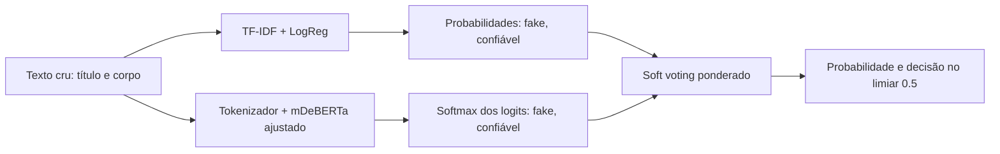

# Ensemble de desinformação

O ensemble com mDeBERTa supervisionado e o classificador importado está ativo
localmente. Veja o [relatório atualizado](mdeberta.md); este documento também
registra a infraestrutura genérica e seu diagnóstico inicial.

## Diagnóstico

O resumo foi impresso no terminal antes das alterações. Os dois artefatos sklearn
existentes foram preservados.

| Fluxo | Dados e processamento | Modelo e avaliação |
|---|---|---|
| Exemplo original | 12 frases; texto cru | TF-IDF `lowercase=True`, `(1,2)`, 5.000 atributos; LogReg `random_state=42`, demais padrões (`C=1`, `lbfgs`, `max_iter=100`); sem validação |
| Notebook v1 | Excel → CSV; remoção de URLs/HTML/pontuação/números/acentos, stopwords PT e stemming RSLP | TF-IDF 5.000 unigramas; LogReg padrão; split estratificado 80/20, seed 42 |
| Notebook v2 | Limpeza com `urltoken`, stopwords e deduplicação; CSVs de treino/holdout | TF-IDF 50.000 atributos `(1,2)`; LinearSVC; GridSearchCV de 5 folds, F1 macro; `max_df ∈ {0.85,1}`, `min_df ∈ {1,2}`, `C ∈ {0.1,1,10}` |
| Artefato priorizado pela API | Título + corpo; vetorização no pipeline | LinearSVC `C=10`, `max_iter=2000`, seed 42; TF-IDF `max_df=0.85`, `min_df=1`, 50.000 atributos `(1,2)` |

Os notebooks e datasets estão em `modelo/identificador-de-fake-news-main.zip`, sob
`notebooks/v1_baseline/` e `notebooks/v2_pipeline_linearsvc/`. Contêm caminhos locais
Windows. `backend/services/scraper.py` extrai artigos com Trafilatura/BeautifulSoup;
`backend/services/analyzer.py` faz a inferência.

A API original interpretava a margem do LinearSVC como `0=real, 1=fake`, aplicava
uma sigmoide sem calibração aprendida e combinava 70% ML com 30% heurísticas.
O caminho legado mantém esse comportamento. Havia um erro para LogReg:
`decision_function` tinha prioridade sobre `predict_proba`, com interpretação
de classe oposta ao exemplo. Agora probabilidades nativas têm prioridade, com a
classe real definida por `PROBABILISTIC_RELIABLE_CLASS` (padrão 1).

**Dados:** o CSV completo na raiz interna do ZIP tem 11.902 registros balanceados,
com `Classe=0` para fake e `Classe=1` para real, diferente da convenção assumida no
caminho legado da API. `texto_bruto` junta título e corpo, mas o corpo exportado já
tem palavras transformadas. Existem pistas de classe, como `#boato` nos títulos,
e fontes distintas por classe. Isso pode inflar a avaliação aleatória. Para medir
ganho semântico, use textos originais revisados e teste externo por fonte/tempo.
O loader não desfaz transformações já presentes no dataset.

Não havia MLflow nem configuração DVC, inclusive no ZIP. Foram corrigidos imports
`app.*` para `backend.*` e o caminho do frontend servido pelo Flask para `frontend/`.

## Arquitetura



`backend/ml/ensemble.py` executa os ramos em threads independentes. A LogReg mantém
a família do baseline, treinada diretamente no texto de entrada: TF-IDF 5.000
unigramas/bigramas, `C=1`, seed 42, `max_iter=1000` para convergência. O Transformer
recebe o mesmo texto, sem stemming ou remoção de acentos e stopwords.

O padrão é [`microsoft/mdeberta-v3-base`](https://huggingface.co/microsoft/mdeberta-v3-base),
modelo multilíngue que precisa de fine-tuning para esta tarefa. Sua escolha não
garante superioridade neste corpus nem explicabilidade automática. As classes
internas dos novos artefatos são `0=fake, 1=confiavel`. `LexicalClassifier` alinha
as colunas de `classes_`; SVC sem probabilidades calibradas e modelos discretos
não entram no soft voting. Os logits passam por softmax numericamente estável.

Os pesos padrão são 0.5/0.5, normalizados, positivos e finitos. Ajuste pesos apenas
na validação; reserve um teste independente para a avaliação final. O Transformer
trunca para os primeiros `max_length` tokens (512 por padrão, incluindo tokens
especiais), faz padding por lote e usa `eval()`/`inference_mode()`. Essa limitação
precisa ser avaliada em notícias longas. A inferência não acessa o Hub.

## Treinamento

```bash
python3 -m venv .venv
source .venv/bin/activate
pip install -r requirements-ml.txt
export HF_HOME="$PWD/.hf-cache"
```

O backend legado requer apenas `requirements.txt`. O treinamento semântico baixa
o modelo base quando ele não está disponível localmente. Com CSV UTF-8 revisado:

```bash
python train_ensemble.py --stage all \
  --data /caminho/noticias.csv --text-column texto --label-column rotulo \
  --real-label real --output-dir models/ensemble \
  --base-model microsoft/mdeberta-v3-base \
  --epochs 3 --batch-size 4 --max-length 512 --weights 0.5 0.5
```

`--real-label` é obrigatório: informe o valor original que significa notícia real
(`real`, `1`, `0` etc.). O dataset deve conter exatamente duas classes; a outra
vira fake. Textos vazios e duplicatas com rótulos conflitantes são recusados.
Duplicatas textuais, ignorando caixa/espaços, são removidas antes dos splits.
Paráfrases, fontes e eventos não são agrupados automaticamente.

Treino/validação/teste usam 60/20/20 estratificados e seed 42. O vocabulário TF-IDF
é aprendido somente no treino. O Trainer seleciona o checkpoint por F1 macro na
validação. O teste não participa da seleção. Defaults semânticos: learning rate
`2e-5`, weight decay `0.01`, warmup `0.1`, três épocas. `--cpu` força CPU; sem ele,
o Trainer usa o dispositivo disponível. Checkpoints intermediários são temporários.

Para treino separado, mantenha os argumentos de dados, seed, frações e diretório:

```bash
python train_ensemble.py --stage lexical --data noticias.csv --text-column texto --label-column rotulo --real-label real
python train_ensemble.py --stage transformer --data noticias.csv --text-column texto --label-column rotulo --real-label real
python train_ensemble.py --stage ensemble --data noticias.csv --text-column texto --label-column rotulo --real-label real
```

A montagem recusa componentes com assinaturas de dados/splits diferentes e avalia
os dois modelos e o ensemble. `--stage all` executa tudo em um run. O manifesto só
é publicado após as avaliações. O treino não sobrescreve um bundle com manifesto;
use outro `--output-dir` para a próxima versão. A etapa `ensemble` pode atualizar
os pesos após validar os componentes.

Para treinar apenas o ramo léxico no CSV fornecido, sem extrair o ZIP:

```bash
python train_ensemble.py --stage lexical \
  --data modelo/identificador-de-fake-news-main.zip \
  --zip-member identificador-de-fake-news-main/fake_recogna_limpo.csv \
  --text-column texto_bruto --label-column Classe --real-label 1
```

Esse export tem as limitações descritas no diagnóstico. O comando
`python train_example_model.py --output-dir /tmp/verificai-example` usa as 12 frases
originais para testar instalação/MLflow; suas métricas não medem qualidade real.

## MLflow e artefatos

O rastreamento é obrigatório; falhas interrompem o treino. Configure
`--tracking-uri` ou `MLFLOW_TRACKING_URI`; o padrão é SQLite em `mlflow.db` na raiz.
Para consultar runs:

```bash
mlflow ui --backend-store-uri "sqlite:///$PWD/mlflow.db"
```

Cada run registra argumentos, parâmetros completos da pipeline sklearn,
`TrainingArguments`, configuração/revisão resolvida do Transformer, versões
instaladas, commit Git, hashes dos dados, índices/assinatura dos splits, contagens,
classes, histórico e artefatos. Use `--revision HASH_DO_COMMIT` para fixar o modelo
base. Seeds são fixadas; dispositivos diferentes podem ter diferenças numéricas.

Métricas de validação/teste por componente e ensemble: acurácia, F1/precisão/recall
macro, ROC AUC, log loss e Brier score. Relatórios de classificação e matrizes de
confusão ficam em `evaluation/`. Runs separados são ligados por
`component_run_ids`. O MLflow recebe o bundle completo na montagem e cada componente
em seu treino isolado.

```text
models/ensemble/
  lexical.joblib
  lexical_metadata.json
  transformer/
    config.json
    model.safetensors
    arquivos do tokenizador
    training_metadata.json
  data_provenance.json
  manifest.json
```

Não foi criado um remote DVC sem configuração existente. Bundles novos, dados,
cache e diretórios MLflow ficam fora do Git. Ao adotar DVC, versione o bundle
inteiro, incluindo manifesto, metadados, tokenizador e pesos: após configurar o
remote, `dvc add models/ensemble` e `dvc push`. Os artefatos legados não são regravados.

## Inferência e ativação

```python
from backend.ml.ensemble import SoftVotingEnsemble

model = SoftVotingEnsemble.from_manifest("models/ensemble/manifest.json")
prediction = model.predict("Texto cru da notícia em português.")
print(prediction["probabilities"], prediction["predicted_class"])
```

A API usa o ensemble com `MODEL_BACKEND=ensemble`, carregando
`models/ensemble/manifest.json`. Escolha outra
versão por `ENSEMBLE_MANIFEST` e dispositivo por `TRANSFORMER_DEVICE` (`auto` padrão,
`cuda` ou `mps`). Reinicie ou chame `POST /api/reload-model` para ativar o bundle.
`MODEL_BACKEND=legacy` seleciona o caminho legado. Sem o bundle final, o padrão
`MODEL_BACKEND=calibrated` seleciona `classificador.joblib`, descrito no
[guia da API local](api-local.md). Um ensemble inválido aparece em `/api/health`
(`ensemble_loaded`, `model_error`) e a análise falha explicitamente.

O checkpoint exige `training_metadata.json`, classes e splits compatíveis; não
aceita simplesmente o modelo base com uma cabeça recém-inicializada. No ensemble,
`POST /api/analyze` mantém a entrada `{"url":"https://..."}`, com `confidence_score`
igual a `100 × P(confiável)` e limiar 50. `ml_details` inclui probabilidades por ramo,
pesos e probabilidades combinadas. Os cinco critérios continuam informativos; não
são atribuições causais dos modelos nem provas factuais.

## Testes

```bash
HF_HUB_OFFLINE=1 TRANSFORMERS_OFFLINE=1 pytest -q
```

A suíte testa o baseline real/API, alinhamento de classes, prioridade de
`predict_proba`, paralelismo, entradas inválidas, carregamento, deduplicação e splits.
Um BERT minúsculo criado localmente faz fine-tuning real, salva/recarrega os pesos,
avalia o ensemble e verifica o MLflow sem rede. Isso valida a integração, sem medir
qualidade do mDeBERTa. Com apenas dependências básicas, os dois testes de treinamento
que precisam de MLflow/Transformer são pulados.

Validação executada: 23 testes aprovados em modo offline. Também foi executado o
treino léxico no CSV do ZIP: 7.140/2.381/2.381 registros de treino/validação/teste,
F1 macro de teste 0,959679 e ROC AUC 0,991046, no run MLflow
`62980323bb964a3ebad59112e9616e51`. Esses resultados são do ramo léxico nesse split,
sujeitos às pistas de classe descritas acima. Não representam uma medição do
ensemble nem do mDeBERTa completo, cujo fine-tuning no corpus real não foi executado.

Referências: [Trainer HuggingFace](https://huggingface.co/docs/transformers/main_classes/trainer)
e [MLflow Tracking](https://mlflow.org/docs/latest/ml/tracking/tracking-api/).
