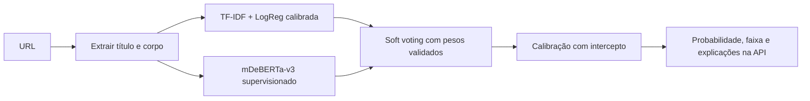

# mDeBERTa nas respostas da API

## Arquitetura implementada

O ensemble combina o classificador importado `classificador.joblib` com um
mDeBERTa-v3 ajustado de forma supervisionada para duas classes:
`0=fake, 1=confiável`. Os dois ramos recebem o mesmo título/corpo e executam em
paralelo. A resposta inclui a probabilidade de cada ramo, seus pesos, a
probabilidade combinada, a faixa e as métricas do experimento.



O ramo léxico conserva a preparação de texto, calibração e ajuste de texto curto
do artefato original. Suas contribuições lexicais continuam na resposta com o
escopo `lexical_component_only`. O Transformer preserva acentos, números e
negações na tokenização e usa os primeiros 256 tokens, incluindo tokens especiais.
A API informa quantos tokens foram usados e se houve truncamento.

## Dados e origem dos rótulos

`banco_fake.csv` contém 1.113 registros com título, corpo e URL. O responsável
confirmou em 13/10/2026 que todos são falsos. O importador registra essa origem
como `user_confirmed_false`; a confirmação não é substituída por uma inferência
baseada no nome do arquivo, portal ou tema.

Para ter ambas as classes, o experimento inclui textos originais do
[Fake.Br Corpus](https://github.com/roneysco/Fake.br-Corpus), dos diretórios
`full_texts/fake` e `full_texts/true`. O dataset final tem 8.295 textos, após remover
18 duplicatas: 4.713 falsos e 3.582 verdadeiros. A preparação mantém textos
originais, sem stemming. Pares Fake.Br recebem o mesmo grupo; URLs do banco
recebem grupos próprios. Os corpos já presentes no CSV evitam baixar novamente
as 1.113 páginas para treinamento.

As partições agrupadas são aproximadamente 60/10/10/20:

| Partição | Registros | Uso |
|---|---:|---|
| Treino | 4.976 | Ajuste dos pesos do Transformer |
| Validação | 829 | Escolha do melhor checkpoint por F1 macro |
| Calibração | 831 | Temperaturas do Transformer e da combinação |
| Teste | 1.659 | Avaliação final |

Há possíveis correlações entre fonte, época e rótulo. O protocolo é experimental.
O classificador importado tem partições históricas próprias, cuja independência
cruzada completa em relação ao novo corpus não foi certificada. O banco contém
apenas negativos; sua métrica específica é recall de fake news, e não F1 macro de
duas classes. Essas limitações são registradas no manifesto e no MLflow.
O F1 macro e o recall binário do experimento usam limiar 0,5. A interface utiliza
adicionalmente a faixa inconclusiva entre os limiares de 0,35 e 0,65.

## Inicialização e fine-tuning

O experimento usa o encoder de
[`MoritzLaurer/mDeBERTa-v3-base-mnli-xnli`](https://huggingface.co/MoritzLaurer/mDeBERTa-v3-base-mnli-xnli),
revisão `8adb042d524ecd5c26d3e3ba0e3fbcf7e2d0864c`, disponível no cache local.
Esse checkpoint deriva do mDeBERTa-v3 da Microsoft e foi ajustado em NLI. Sua
cabeça de três classes é substituída por uma cabeça binária, que é treinada no
novo corpus antes de qualquer ativação na API.

| Parâmetro | Valor |
|---|---|
| Épocas | 2 |
| Camadas do encoder congeladas | 10 de 12, além dos embeddings |
| Camadas ajustadas | Últimas duas, pooler e cabeça binária |
| Batch por dispositivo | 4 |
| Acumulação de gradiente | 2 |
| Learning rate do encoder ajustado | `2e-5` |
| Learning rate da cabeça/pooler | `1e-3` |
| Weight decay | `0.01` |
| Warmup | `0.1` |
| Comprimento máximo | 256 tokens |
| Seed | 42 |
| Dispositivo utilizado | GPU Apple via MPS |

O Trainer seleciona o checkpoint pela validação. Depois, uma temperatura é
ajustada na partição de calibração para os logits semânticos. O primeiro experimento combinou as probabilidades em 50/50 e mostrou queda de
F1 na validação devido ao viés de probabilidade do classificador importado.

Na etapa final, cinco combinações de pesos foram comparadas na validação. Para
cada uma, temperatura e intercepto foram ajustados na reserva de calibração.
A seleção usou F1 macro, com log loss como desempate, e escolheu 90% para a saída
léxica e 10% para a saída semântica. Ambos os componentes continuam participando.
O teste foi avaliado depois dessa seleção.

A calibração final usa temperatura `0,2480946511` e intercepto `9,835101002` na
log-odds da classe falsa da média ponderada. Ela corrige o deslocamento observado
nesse corpus; as probabilidades originais dos componentes permanecem separadas
na resposta. A temperatura semântica é `1,6478583044`.

O ajuste de texto curto informado pela API pertence ao ramo léxico. A calibração
do ensemble foi estimada no corpus descrito; o comportamento em textos muito
curtos e outras distribuições precisa de avaliação adicional.

As faixas seguem a política do projeto: P(fake) até 0,35 → verdadeira; acima de
0,35 até 0,65 → inconclusiva; acima de 0,65 → falsa. A pontuação é
`100 × P(confiável)` do ensemble calibrado. Os cinco sinais heurísticos continuam
informativos e não entram nessa combinação.

## Reproduzir a preparação e o treinamento

```bash
source .venv-classificador/bin/activate
python -m pip install -r requirements-classificador.txt -r requirements-ml.txt

python scripts/prepare_mdeberta_data.py --confirm-banco-false

PYTORCH_ENABLE_MPS_FALLBACK=1 TOKENIZERS_PARALLELISM=false \
python train_mdeberta.py \
  --base-model .hf-cache/mdeberta-initial \
  --source-model MoritzLaurer/mDeBERTa-v3-base-mnli-xnli \
  --source-revision 8adb042d524ecd5c26d3e3ba0e3fbcf7e2d0864c \
  --replace-classification-head

PYTORCH_ENABLE_MPS_FALLBACK=1 TOKENIZERS_PARALLELISM=false \
python train_mdeberta.py --calibrate-existing
```

O importador espera `data/raw/fakebr.zip` e `data/raw/fakebr_revision.json`,
baixados do repositório original, e grava `data/processed/mdeberta_news.csv` e sua
procedência. O checkpoint inicial em `.hf-cache/mdeberta-initial` deve conter os
arquivos da revisão indicada. Para baixar diretamente do Hub, passe o identificador
do modelo em `--base-model` e fixe a revisão com `--revision` e `--source-revision`.

`--cpu` força CPU. Os argumentos permitem ajustar batch, épocas, camadas
congeladas e diretório de saída. Um bundle já concluído não é sobrescrito; use
outro `--output-dir` para uma nova versão.

## Bundle, MLflow e ativação

```text
models/mdeberta-ensemble/
  classificador.joblib
  transformer/
    model.safetensors
    config.json
    arquivos do tokenizador
    training_metadata.json
  data_provenance.json
  manifest.json
```

O manifesto v2 identifica o classificador importado por hash, as partições do
Transformer, as temperaturas, os pesos e a avaliação por componente. O MLflow
registra o experimento, os argumentos, parâmetros treináveis, histórico,
procedência dos dados, manifesto original do classificador e bundle final.
O diretório e os datasets ficam fora do Git; caso DVC seja adotado, o bundle deve
ser versionado inteiro.

O manifesto só é publicado após treinamento, calibração e avaliação. Na ausência
de `MODEL_BACKEND` explícito, a aplicação seleciona esse bundle quando ele existe;
caso contrário, usa o classificador calibrado. Reinicie a API após a publicação:

```bash
python run.py
```

Também é possível selecionar explicitamente:

```bash
MODEL_BACKEND=ensemble \
ENSEMBLE_MANIFEST=models/mdeberta-ensemble/manifest.json \
TRANSFORMER_DEVICE=auto python run.py
```

`MODEL_BACKEND=calibrated` mantém apenas o classificador original. O dispositivo
`auto` seleciona CUDA, MPS ou CPU conforme disponibilidade. A inferência carrega
apenas arquivos locais e serializa o acesso ao Transformer para evitar forwards
concorrentes no mesmo dispositivo.

## Campos adicionais da API

| Campo | Conteúdo |
|---|---|
| `/api/health → model.transformer` | Modelo semântico carregado, tarefa, dispositivo e limite de tokens |
| `ml_details.component_probabilities` | Probabilidades léxicas e semânticas separadas |
| `ml_details.weights` | Pesos normalizados de cada ramo |
| `ml_details.temperature` / `bias` | Temperatura e intercepto aplicados à combinação |
| `ml_details.transformer` | Origem, tarefa supervisionada, temperatura, tokens utilizados e run de treino |
| `model_evaluation.splits.test` | Métricas de teste do classificador importado, Transformer e ensemble |
| `ml_details.explicacao.scope` | Escopo léxico das contribuições exibidas |

A interface apresenta os componentes e suas métricas. A classificação continua
sendo uma estimativa textual; o Transformer não consulta fontes externas para
confirmar a veracidade de uma alegação.


## Resultado executado e versão ativa

O bundle está treinado, calibrado e ativo localmente na API, com a versão
`mdeberta-ensemble-20261013T185545`. O health confirmou backend `ensemble`,
Transformer carregado em `mps` e tarefa `supervised_fake_news`.

| Modelo | F1 macro no teste | ROC AUC | Log loss | Brier |
|---|---:|---:|---:|---:|
| Classificador importado, saída original | 0,3594 | 0,9118 | 1,5709 | 0,4624 |
| mDeBERTa calibrado | 0,8773 | 0,9531 | 0,2781 | 0,0866 |
| Ensemble após seleção e calibração | 0,8814 | 0,9606 | 0,2715 | 0,0827 |

Esses números são do novo teste de 1.659 registros. O desempenho do classificador
importado nesse corpus difere de suas métricas históricas; não devem ser comparados
como se fossem o mesmo dataset/protocolo. O ganho do ensemble sobre o Transformer
foi pequeno neste teste e não certifica ganho em outras fontes/épocas.

Dos 225 registros do `banco_fake.csv` reservados para teste, o ensemble obteve
recall da classe falsa de 84,89% no limiar binário, 80,89% na faixa falsa
(`P(fake)>0,65`) e 8% de resultados inconclusivos.

- Run de fine-tuning: `658901685b1e42f88a0957f73a8e12e9`.
- Run de seleção/calibração: `8ab1f341b2604e19a894cfd209ca20e2`.
- Validação automatizada da integração semântica: 46 testes aprovados; a suíte
  de portabilidade acrescenta cinco testes de transferência de artefatos.
- POST real ao servidor com notícia do G1: HTTP 200, score combinado
  `89,3191091893`; P(fake) léxica `0,0324950033`, semântica `0,1969695661` e final
  `0,1068089081`. O ramo semântico usou 256 de 792 tokens.

O artefato continua marcado como experimental e `production_ready=false`.

Para levar esta versão treinada a outra máquina, siga o
[guia de continuação em outro ambiente](continuacao-em-outro-ambiente.md).
