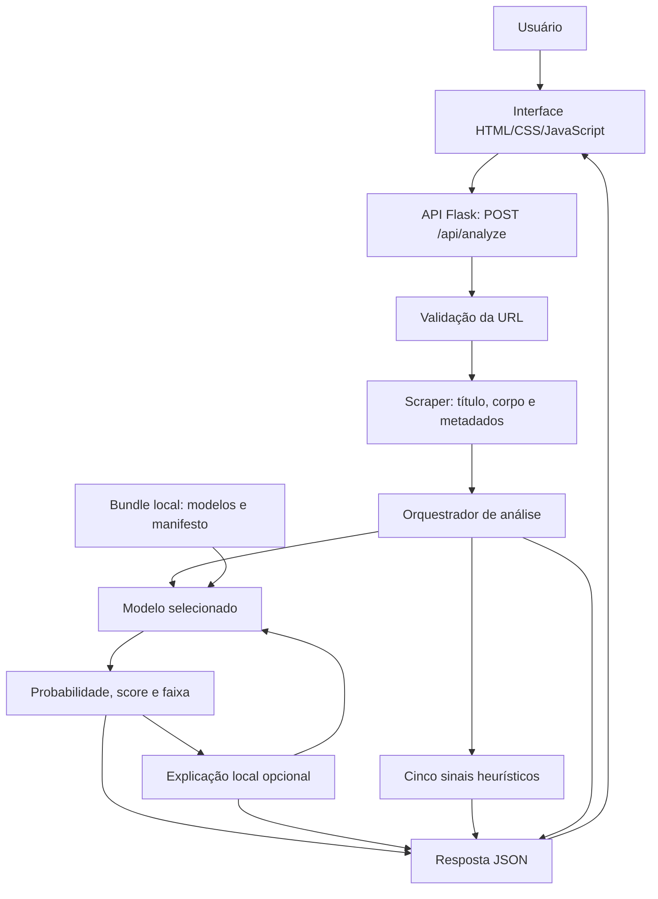

# VerificAI — documentação geral do projeto

**Atualização:** 15/10/2026.

**Escopo:** desenvolvimento, abordagem, modelo, arquitetura, APIs e operação.

**Referência do modelo:** `mdeberta-ensemble-20261013T185545`.

Este documento descreve a implementação presente no repositório, incluindo as
alterações locais da interface e da explicação por trechos. Não comprova que
essas alterações estejam publicadas em um servidor. Os resultados de aprendizado
de máquina são os registrados nos artefatos; não foram recalculados para produzir
esta documentação.

## 1. Visão geral e objetivo

O VerificAI recebe a URL de uma notícia, extrai título e corpo e produz uma
estimativa de confiabilidade baseada em padrões textuais. A aplicação oferece
uma pontuação, uma faixa de interpretação, explicações locais da previsão e
sinais auxiliares para apoiar a leitura antes do compartilhamento.

A abordagem combina classificação supervisionada, calibração probabilística e
heurísticas de texto. O sistema **não confirma fatos em fontes independentes**.
Uma notícia bem escrita pode conter alegações falsas; um texto com linguagem
incomum pode ser verdadeiro. Os rótulos apresentados são estimativas do modelo.

A solução atual reúne uma interface HTML/CSS/JavaScript e uma API Flask no mesmo
projeto. Os modelos são carregados de arquivos locais. Treinamento e avaliação
ocorrem em scripts separados da aplicação web.

## 2. Escopo e requisitos

| Área | Comportamento implementado |
|---|---|
| Entrada | Receber uma URL HTTP/HTTPS em JSON e validar seu formato |
| Extração | Baixar a página e identificar texto principal e metadados |
| Classificação | Executar o backend de modelo selecionado |
| Resultado | Retornar probabilidades, score e faixa de interpretação |
| Explicação | Comparar a previsão com variantes sem determinados trechos, quando habilitado e suportado |
| Sinais auxiliares | Apresentar cinco grupos de heurísticas textuais |
| Diagnóstico | Informar disponibilidade, versão, dispositivo e erros dos modelos |
| Rastreabilidade | Registrar metadados, hashes e informações de procedência na resposta |
| Distribuição | Disponibilizar o bundle treinado por Git LFS e checar sua integridade |

O uso principal pressupõe uma página pública com texto acessível. Paywalls,
bloqueios e páginas cujo conteúdo dependa da execução de JavaScript podem impedir
a extração. Não há navegador automatizado no fluxo de scraping.

A versão atual não implementa contas de usuários, histórico persistente de
consultas, fila de tarefas, cache de resultados ou armazenamento automático do
conteúdo extraído. Também não estabelece metas verificadas de disponibilidade,
volume de requisições ou latência em produção.

## 3. Desenvolvimento e evolução

O projeto preserva artefatos anteriores e evoluiu em etapas descritas no
[acompanhamento do desenvolvimento](evolucao-projeto.md) e no
[diagnóstico do ensemble](ensemble.md).

| Etapa | Desenvolvimento e consequência |
|---|---|
| Baselines | Exemplo pequeno com TF-IDF/LogReg e notebooks históricos de regressão logística e LinearSVC |
| API por URL | Extração com Trafilatura/BeautifulSoup e integração de um modelo local com heurísticas |
| Classificador calibrado | Integração do artefato `classificador.joblib`, preservando preparação de texto, calibração e ajuste para entradas curtas |
| Infraestrutura de ensemble | Componentes separados, alinhamento de classes, combinação de probabilidades e rastreamento com MLflow |
| mDeBERTa supervisionado | Preparação de textos originais, fine-tuning, calibração e avaliação em partições agrupadas |
| Bundle selecionado | Combinação léxica/semântica escolhida na validação e ativável na API local |
| Distribuição | Pesos e tokenizadores em Git LFS, checksums e scripts de verificação e transferência |
| Interface e explicabilidade | Separação entre resultado principal, sinais auxiliares e informações técnicas; explicação por remoção de trechos |

Os protótipos de interface anteriores estão em `archive/`. Os notebooks e dados
históricos do baseline permanecem no ZIP em `modelo/`. Eles documentam a evolução,
mas não definem sozinhos o comportamento da versão atual.

Há diferenças entre os protocolos: o treinamento genérico de ensemble pode usar
60/20/20 e outros limites de tokens; o bundle supervisionado descrito aqui usa
aproximadamente 60/10/10/20 e 256 tokens. As configurações do artefato selecionado
devem prevalecer ao interpretar seu resultado.

## 4. Arquitetura geral

A arquitetura de execução é uma aplicação web em Python com serviços organizados
por responsabilidade. Não há serviços de inferência externos ou microserviços
separados na implementação atual.



O modelo é carregado na inicialização dos serviços e reutilizado entre análises.
O endpoint de recarga permite reabrir os artefatos locais. A configuração é lida
do ambiente ao importar o módulo; trocar variáveis de ambiente exige reiniciar
o processo para que a nova configuração seja aplicada.

### Componentes e responsabilidades

| Componente | Responsabilidade | Implementação |
|---|---|---|
| Interface | Formulário, chamada da API, interpretação e painéis de resultado | [frontend/](../frontend/) |
| Aplicação Flask | Criar a aplicação, habilitar CORS e servir os arquivos estáticos | [backend/__init__.py](../backend/__init__.py) |
| Rotas | Validar requisições, chamar os serviços e mapear erros HTTP | [backend/routes.py](../backend/routes.py) |
| Configuração | Selecionar modelos, caminhos, dispositivo e limites | [backend/config.py](../backend/config.py) |
| Validador | Verificar esquema, tamanho e host da URL | [backend/utils/validators.py](../backend/utils/validators.py) |
| Scraper | Baixar HTML e extrair texto e metadados | [backend/services/scraper.py](../backend/services/scraper.py) |
| Analisador | Orquestrar predição, heurísticas, explicação e procedência | [backend/services/analyzer.py](../backend/services/analyzer.py) |
| Explicador | Medir mudanças na probabilidade ao remover trechos | [backend/services/explainer.py](../backend/services/explainer.py) |
| Adaptadores de ML | Carregar e executar classificador, Transformer e ensemble | [backend/ml/](../backend/ml/) |
| Motor léxico original | Preparação, artefato, calibração, inferência e treinamento | [ml/](../ml/) |
| Distribuição e dados | Preparar corpus, verificar pesos e transferir artefatos | [scripts/](../scripts/) |

## 5. Fluxo de processamento de uma URL

1. O usuário informa uma URL. A interface envia `POST /api/analyze` para a mesma
   origem que serve a aplicação.
2. A API exige um objeto JSON e valida o campo `url`. URLs inválidas são recusadas
   antes da extração.
3. Nos modos calibrado e ensemble, a API verifica a disponibilidade do modelo.
   Um modelo indisponível não é substituído por um score heurístico.
4. O scraper faz uma requisição HTTP, seguindo redirecionamentos, com timeout
   configurável. Trafilatura extrai o conteúdo principal; BeautifulSoup completa
   metadados e oferece uma extração alternativa por parágrafos.
5. O analisador calcula as heurísticas e executa o modelo com título e corpo.
6. A probabilidade determina score e faixa. Quando habilitada e suportada, a
   explicação local avalia variantes do documento com trechos removidos.
7. A resposta reúne resultado, metadados, explicações, métricas do experimento
   e procedência. A interface organiza esses campos para o leitor.

O processamento é síncrono: a requisição aguarda extração, inferência e explicação.
Não há um identificador de tarefa para consultar posteriormente. Acesso à notícia
exige rede; a inferência dos pesos já instalados ocorre localmente.

O scraper retorna título, texto, autor, data, domínio, contagem de palavras,
contagem de links e informações da extração. A contagem chamada
`external_links_count` considera links HTTP encontrados na página; ela não
certifica que sejam referências independentes ou externas ao portal.

## 6. Abordagem de aprendizado de máquina

### Modos de inferência

| `MODEL_BACKEND` | Composição | Relação com as heurísticas |
|---|---|---|
| `ensemble` | Classificador calibrado importado + Transformer, com combinação definida no manifesto | Não alteram o score |
| `calibrated` | Artefato `classificador.joblib` e seu motor original | Não alteram o score |
| `legacy` | Artefatos históricos, incluindo LinearSVC, com regras de adaptação legadas | Quando há score de ML, combina 70% ML e 30% heurísticas; sem modelo pode usar somente heurísticas |

Sem seleção explícita, a existência de
`models/mdeberta-ensemble/manifest.json` faz o padrão ser `ensemble`; caso
contrário, é `calibrated`. Essa escolha verifica a existência do manifesto, não
a disponibilidade completa dos pesos. Um clone com ponteiros LFS ainda não
baixados pode selecionar ensemble e apresentar erro de carregamento.

O carregador genérico aceita manifestos de ensemble de diferentes versões. O
bundle atual usa `schema_version=2`, com `CalibratedDeepEnsemble`. Suas classes
internas são `0 = fake` e `1 = confiavel`. Artefatos históricos podem ter outras
convenções, tratadas pelos respectivos adaptadores.

### Ramo léxico

O classificador importado utiliza atributos TF-IDF de palavras e caracteres e
regressão logística calibrada. Seu motor prepara título e corpo, remove HTML
residual, normaliza Unicode e espaços e converte para minúsculas, preservando
números, negações e conteúdo lexical.

A inferência mantém a calibração e a contração de probabilidades do artefato.
Textos abaixo do comprimento mínimo registrado recebem ajuste em direção a 0,5.
O carregamento verifica, entre outros itens, classes, versão do scikit-learn e
hash do pré-processamento. Isso evita executar o artefato com uma preparação
diferente da registrada.

Esse ramo considera o texto completo preparado. As contribuições de palavras
retornadas pelo motor dizem respeito ao ramo léxico e não explicam, isoladamente,
o ensemble final. Os cartões antigos de termos foram removidos da interface.

### Ramo semântico

O Transformer é um mDeBERTa-v3 inicializado a partir de
`MoritzLaurer/mDeBERTa-v3-base-mnli-xnli`, revisão
`8adb042d524ecd5c26d3e3ba0e3fbcf7e2d0864c`. A cabeça original de três classes
foi substituída por uma cabeça binária e ajustada para classificação de notícias.

O experimento documentado utilizou duas épocas, seed 42, batch de quatro e
acumulação de gradiente de dois. Embeddings e dez das doze camadas do encoder
ficaram congelados; as duas últimas camadas, pooler e cabeça foram ajustados.
O treinamento registrado ocorreu em GPU Apple via MPS.

Na inferência, título e corpo são concatenados e tokenizados sem a limpeza
lexical do outro ramo. O limite é de **256 tokens**, incluindo os especiais.
Os logits passam por calibração de temperatura e softmax. A API informa se
houve truncamento e quantos tokens foram utilizados.

O carregamento usa apenas arquivos locais. O dispositivo `auto` escolhe CUDA,
MPS ou CPU, conforme disponibilidade. Um bloqueio de acesso ao Transformer
serializa seus forwards no dispositivo; isso não equivale a uma fila de tarefas
da aplicação.

### Combinação e calibração final

Os dois ramos executam em threads independentes. Para cada classe, a combinação
inicial é uma média ponderada das probabilidades. Nesta versão:

```text
q = 0,9 × probabilidades léxicas + 0,1 × probabilidades semânticas
P(fake) final = sigmoid(ln(q_fake / q_confiável) / T + b)
P(confiável) final = 1 − P(fake) final
```

O código protege os logaritmos contra valores nulos. A calibração final tem
`T ≈ 0,248095` e `b ≈ 9,835101`. A temperatura do ramo semântico é
`≈ 1,647858`. Esses parâmetros pertencem ao experimento registrado; não são
constantes universais para outras versões.

Os pesos foram escolhidos na validação entre cinco candidatos. Para cada
candidato, a calibração foi ajustada na reserva de calibração. A seleção priorizou
F1 macro, com log loss como desempate. Um peso de 90% não significa 90% de
importância causal nem 90% de acertos atribuíveis ao ramo léxico.

### Pontuação e faixas

```text
confidence_score = 100 × P(confiável) final
```

| P(fake) final | Faixa interna | Rótulo apresentado |
|---|---|---|
| Até 0,35 | `verdadeira` | Provavelmente verdadeira |
| Acima de 0,35 e até 0,65 | `inconclusiva` | Resultado inconclusivo |
| Acima de 0,65 | `falsa` | Possível desinformação |

A faixa inconclusiva é uma regra de decisão, não uma terceira classe aprendida.
As métricas binárias usam `P(confiável) >= 0,5` para a classe confiável. Um score
individual não representa a acurácia global do sistema.

## 7. Dados, treinamento e avaliação

O corpus do experimento supervisionado reúne textos originais do Fake.Br e
registros do `banco_fake.csv`, confirmados como falsos pelo responsável em
13/10/2026. Após a remoção de 18 duplicatas, contém **8.295 textos: 4.713 falsos
e 3.582 verdadeiros**.

| Partição | Textos | Uso |
|---|---:|---|
| Treino | 4.976 | Ajustar o Transformer |
| Validação | 829 | Selecionar checkpoint e pesos |
| Calibração | 831 | Ajustar parâmetros de calibração |
| Teste | 1.659 | Avaliar a configuração selecionada |

O particionamento usa `StratifiedGroupKFold` e seed 42. Pares do Fake.Br e grupos
por URL não cruzam partições. Textos duplicados, ignorando caixa e espaços, e
URLs duplicadas são tratados antes da divisão. Isso não exclui todas as
paráfrases nem garante independência em relação ao treino histórico do artefato
léxico importado.

### Resultados registrados

Os três componentes foram avaliados no mesmo teste de 1.659 textos:

| Modelo | Acurácia | F1 macro | ROC AUC | Log loss | Brier |
|---|---:|---:|---:|---:|---:|
| Léxico importado | 0,4623 | 0,3594 | 0,9118 | 1,5709 | 0,4624 |
| mDeBERTa calibrado | 0,8807 | 0,8773 | 0,9531 | 0,2781 | 0,0866 |
| Ensemble calibrado | 0,8849 | 0,8814 | 0,9606 | 0,2715 | 0,0827 |

Fonte: `evaluation.splits.test` no
[manifesto](../models/mdeberta-ensemble/manifest.json). Valores arredondados a
quatro casas. O ganho de F1 macro do ensemble sobre o Transformer é pequeno;
não há intervalo de confiança ou evidência de significância estatística nesse
manifesto. As métricas históricas do classificador importado pertencem a outro
protocolo e não substituem essa comparação.

F1 macro equilibra o desempenho das duas classes; ROC AUC avalia ordenação;
log loss e Brier avaliam probabilidades e devem ser minimizados. Consulte as
definições, fórmulas e limitações na [documentação de métricas](metricas-avaliacao.md).

### Organização dos fluxos de treinamento

| Entrada ou módulo | Finalidade |
|---|---|
| [scripts/prepare_mdeberta_data.py](../scripts/prepare_mdeberta_data.py) | Preparar e deduplicar Fake.Br e banco confirmado |
| [train_mdeberta.py](../train_mdeberta.py) | Iniciar treinamento supervisionado ou calibração do bundle existente |
| [backend/ml/deep_training.py](../backend/ml/deep_training.py) | Partições agrupadas, fine-tuning e montagem inicial |
| [backend/ml/deep_calibration.py](../backend/ml/deep_calibration.py) | Seleção de pesos e calibração final |
| [train_ensemble.py](../train_ensemble.py) | Executar o fluxo genérico de ensemble, distinto do bundle v2 atual |
| [ml/train.py](../ml/train.py) | Treinar e avaliar o classificador calibrado em seu protocolo próprio |

O MLflow registra parâmetros, versões, hashes, partições, histórico, métricas
e artefatos do fluxo de ensemble. O armazenamento padrão é SQLite em `mlflow.db`,
com artefatos locais em `mlruns/`. Esses arquivos apoiam o desenvolvimento e
não são necessários para servir o bundle pronto.

Os identificadores registrados são:

- Fine-tuning: `658901685b1e42f88a0957f73a8e12e9`.
- Seleção e calibração: `8ab1f341b2604e19a894cfd209ca20e2`.

Para reproduzir o experimento, siga o [guia do mDeBERTa](mdeberta.md), preservando
corpus, revisões e partições. Novos treinamentos devem usar outro diretório de
saída. A opção de calibrar um bundle existente é um fluxo específico e pode
atualizar seu manifesto.

## 8. Explicabilidade e sinais auxiliares

### Explicação local da previsão final

O módulo de explicabilidade usa remoção de frases, identificado como
`sentence_deletion`. Ele compara a previsão original com previsões do mesmo
modelo e calibração depois de remover um trecho por vez. Não utiliza LLM nem
retreina os pesos.

```text
efeito_pp = 100 × (P(fake) original − P(fake) sem o trecho)
```

Efeito positivo indica que retirar o trecho reduziu a probabilidade da classe
falsa. Efeito negativo indica o sentido oposto. Efeitos menores que 0,5 ponto
percentual em módulo não são destacados.

Por padrão, são avaliados até oito candidatos, com limite configurável de um
a dezesseis. O título tem prioridade; frases do corpo são amostradas ao longo
do texto. O resultado mostra até três exemplos em cada sentido e informa
cobertura, limites e tempo adicional. No ensemble, as variantes são processadas
em lotes de dois.

A explicação é retornada em `ml_details.explicacao.local`, com estados `ok`,
`no_effect`, `insufficient_text` ou `unavailable`. Uma falha nessa etapa preserva
a classificação original. Quando a funcionalidade está desabilitada, o campo
local é omitido. A referência do modelo usada na previsão é mantida durante
as comparações, mesmo se ocorrer recarga do serviço.

Remover trechos também muda contexto, comprimento e a janela de tokens do
Transformer. Os efeitos não são somáveis nem provam causalidade ou veracidade.
O método e o contrato estão detalhados no [guia de explicabilidade](explicabilidade.md).

### Sinais heurísticos

| Campo na API | Interpretação na aplicação |
|---|---|
| `evidencias` | Indícios textuais de dados, referências e atribuições |
| `qualidade_fontes` | Regras envolvendo domínio, autoria, links e texto |
| `corroboracao` | Padrões de linguagem e sensacionalismo; exibido como “Linguagem e sensacionalismo” |
| `contexto` | Características de título, corpo e extensão |
| `atualidade` | Data identificada e sinais temporais |

São regras programadas, não cinco modelos treinados nem uma verificação externa
das fontes. Nos modos calibrado e ensemble, não entram na pontuação final.
No modo legado, participam da regra de combinação descrita anteriormente.

## 9. Interface e organização das informações

A interface atual é servida pelo próprio Flask, sem etapa de build ou execução
de Vite. O resultado está organizado nesta ordem:

1. **Estimativa de confiabilidade:** score, faixa e metadados de origem.
2. **Como interpretar:** resumo e, quando disponíveis, trechos comparados pela
   explicação local, com cobertura e limitações. Respostas anteriores usam uma
   interpretação compatível com a faixa.
3. **Sinais auxiliares do texto:** painel independente, logo acima das informações
   técnicas e com a mesma largura.
4. **Informações técnicas:** probabilidades, componentes, pesos, limiares, versão,
   calibração, truncamento e métricas do experimento.

Os dois painéis ficam recolhidos a cada nova análise. Os cartões “Termos que
favorecem” e “Termos que desfavorecem” não são exibidos. Os trechos da explicação
local são inseridos como texto, sem interpretar o HTML de uma notícia.

A resposta JSON continua contendo informações técnicas para integrações. Ocultar
um campo na apresentação não o remove do contrato da API.

## 10. API e contratos

| Método | Caminho | Função |
|---|---|---|
| GET | `/` | Interface da aplicação |
| GET | `/docs` | Documentação interativa |
| GET | `/api` ou `/api/` | Índice da API |
| GET | `/api/openapi.json` | Especificação OpenAPI |
| GET | `/api/health` | Estado dos modelos e diagnóstico |
| POST | `/api/analyze` | Extração e análise de uma URL |
| POST | `/api/reload-model` | Recarregar os artefatos locais |

Exemplo de requisição, com o servidor local ativo:

```bash
curl -X POST http://localhost:5001/api/analyze \
  -H 'Content-Type: application/json' \
  -d '{"url":"https://exemplo.com.br/noticia"}'
```

A URL é ilustrativa; use uma notícia pública acessível para executar a análise.

| Grupo de campos da resposta | Conteúdo |
|---|---|
| `confidence_score`, `prob_fake`, `faixa`, `verdict_label` | Estimativa e decisão apresentada |
| `metadata` | Título, autoria, data, domínio e contagem de palavras |
| `ml_details` | Modelo, probabilidades, componentes e explicações |
| `model_evaluation` | Métricas do experimento associado ao artefato |
| `criteria`, `criteria_affect_score` | Sinais heurísticos e sua relação com o score |
| `provenance` | Instante, hashes e metadados da extração |

### Falhas e disponibilidade

| HTTP | Situação |
|---|---|
| 200 | Análise concluída; no health, também pode indicar estado `degraded` no JSON |
| 400 | JSON inválido, corpo diferente de objeto ou URL inválida |
| 422 | Falha de acesso à página ou extração insuficiente |
| 503 | Modelo selecionado indisponível ou falha na inferência |
| 500 | Erro inesperado no processamento |

O health usa HTTP 200 mesmo quando o modelo está degradado; o consumidor deve
inspecionar `status`, `model.loaded` e `model_error`. Uma explicação indisponível
não transforma uma classificação válida em erro HTTP. O contrato detalhado está
no [guia da API local](api-local.md) e em [backend/openapi.py](../backend/openapi.py).

## 11. Artefatos e reprodutibilidade

```text
models/mdeberta-ensemble/
  manifest.json                 Versão, classes, pesos, calibração e métricas
  data_provenance.json          Origem, hashes e partições do corpus
  checksums.json                Inventário de integridade dos arquivos
  classificador.joblib          Artefato léxico importado
  transformer/
    model.safetensors           Pesos ajustados
    config.json                 Configuração da cabeça e do encoder
    training_metadata.json      Tarefa, revisão, tokens, temperatura e run
    ...                         Tokenizador e arquivos associados
```

Pesos e arquivos grandes do tokenizador usam Git LFS. Manifestos, configurações
e checksums permanecem no Git normal. Ambientes, caches, dados preparados,
histórico MLflow e exportações locais são tratados separadamente. DVC não está
configurado no projeto.

O bundle v2 verifica o hash do classificador, compatibilidade de classes, tarefa
supervisionada e assinatura de partições. A verificação completa do inventário
é feita por `scripts/check_model.py --verify-hashes`; não deve ser confundida
com as validações parciais executadas durante o carregamento.

Cada análise retorna hash de título/corpo, instante e informações de extração,
incluindo URL solicitada, URL final e versões das bibliotecas. O conteúdo completo
não é persistido automaticamente, portanto o hash não permite reconstruir uma
notícia que tenha mudado no portal.

O script [scripts/transfer_artifacts.py](../scripts/transfer_artifacts.py) oferece
transferência dos bundles, dados e histórico local, com hashes e verificações
de importação. Consulte o [guia de continuação](continuacao-em-outro-ambiente.md).

## 12. Ambiente, execução e validação

O ambiente documentado como validado é Python 3.14.6 em macOS arm64. CPU é
suportada; GPU é opcional. A compatibilidade em outras plataformas depende das
dependências e ainda precisa de validação específica.

### Instalação e execução local

Com o repositório já clonado, em macOS/Linux:

```bash
git lfs install
git lfs pull
python3.14 -m venv .venv-classificador
source .venv-classificador/bin/activate
python -m pip install -r requirements-inference.txt
python scripts/check_model.py --verify-hashes
MODEL_BACKEND=ensemble PORT=5001 python run.py
```

Abra `http://localhost:5001`. As instruções para Windows e instalação completa
estão no [README](../README.md). Para treinamento, use as dependências e os
comandos do guia específico; servir o modelo não exige MLflow ou novo treinamento.

### Configuração principal

| Variável | Padrão ou função |
|---|---|
| `MODEL_BACKEND` | `ensemble` se o manifesto supervisionado existir; senão `calibrated` |
| `ENSEMBLE_MANIFEST` | Caminho do manifesto selecionado |
| `CLASSIFIER_PATH` | `models/classificador.joblib`, no modo calibrado |
| `ENSEMBLE_ENABLED` | `true`; controla a ativação do ensemble |
| `TRANSFORMER_DEVICE` | `auto`; também aceita `cpu`, `mps` e `cuda` |
| `XAI_ENABLED` | `true`; habilita explicação local nos modelos compatíveis |
| `XAI_MAX_EVALUATIONS` | `8`; orçamento de comparações, limitado entre 1 e 16 |
| `SCRAPER_TIMEOUT` | `15` segundos para a requisição à página |
| `APP_HOST` | `127.0.0.1` na execução de `run.py` |
| `PORT` | `5000`; exemplos usam `5001` |
| `FLASK_DEBUG` | A execução direta de `run.py` usa `false` quando ausente |

O arquivo `.env` não é carregado automaticamente. As variáveis precisam estar
definidas no ambiente antes da inicialização. O README mostra como carregar o
arquivo de exemplo explicitamente.

### Verificações disponíveis

```bash
python -m pip check
python scripts/check_model.py --verify-hashes
python scripts/smoke_test.py
HF_HUB_OFFLINE=1 TRANSFORMERS_OFFLINE=1 python -m pytest -q
```

Para desenvolvimento, instale `requirements-lock.txt` no ambiente apropriado
antes da suíte completa. Quando Node.js estiver disponível, também podem ser
executados:

```bash
node --check frontend/app.js
node --test tests/test_frontend_xai.cjs
```

A suíte cobre contratos da API, inferência, classes, calibração, treinamento,
partições, distribuição, transferência e explicabilidade. Há testes com modelos
pequenos locais para integração. O smoke test utiliza HTML sintético com extração
e modelos reais. Essas verificações não substituem avaliação de qualidade em
notícias reais, testes de carga ou conferência visual da interface.

Os comandos acima são instruções de validação; esta documentação não declara
uma nova execução da suíte. O fluxo de contribuição e atualização dos pesos
está em [CONTRIBUTING.md](../CONTRIBUTING.md).

## 13. Decisões de arquitetura e compromissos

| Decisão | Motivo e consequência |
|---|---|
| Interface estática servida pelo Flask | Simplifica a execução local e o acesso à API pela mesma origem; não exige Node.js para uso |
| Inferência com pesos locais | Dispensa serviço externo de predição; exige distribuição e memória para o bundle |
| Ensemble léxico e semântico | Permite combinar representações diferentes; adiciona custo e demanda avaliação conjunta |
| Calibração separada | Ajusta probabilidades no corpus reservado; sua adequação em outras distribuições precisa ser medida |
| Janela de 256 tokens | Limita o contexto e o custo do Transformer; pode excluir partes relevantes de notícias longas |
| Explicação por remoção de trechos | Mede o efeito local na saída real; exige inferências adicionais e altera o contexto da entrada |
| Heurísticas separadas do score atual | Permite oferecer sinais de leitura sem misturá-los à probabilidade do ensemble |
| Processamento síncrono | Mantém o fluxo simples; scraping e explicação aumentam o tempo de resposta |
| Preservação do legado | Mantém comparações e compatibilidade; exige atenção às diferenças de classes e protocolos |

## 14. Limitações operacionais e próximas evoluções

O manifesto marca o bundle como **experimental**, com `production_ready=false`.
A qualidade observada depende do corpus e de seu protocolo. Há possíveis
correlações entre fonte, época e rótulo; não foi certificada a independência
completa do treinamento histórico do ramo léxico. A explicação por trechos
também precisa de avaliação humana e de fidelidade em notícias reais.

Na operação, o projeto possui logs, health e diagnóstico de carregamento, mas
não implementa autenticação, limitação de requisições ou proteção administrativa
para `/api/reload-model`. CORS permite qualquer origem nas rotas da API.
A validação de URL bloqueia alguns endereços locais explícitos, mas não verifica
integralmente redes privadas, resolução DNS e cada redirecionamento. Essas
restrições descrevem o estado do código, não uma certificação de segurança.

As principais evoluções identificadas são:

- Avaliar generalização em fontes e períodos externos ao desenvolvimento,
  incluindo textos curtos e notícias longas.
- Esclarecer sobreposição com o treino histórico do classificador importado e
  informar incerteza nas comparações entre modelos.
- Persistir conteúdo extraído e resultados, quando necessário, para reprodução
  das análises e acompanhamento de versões.
- Medir latência, memória e concorrência com explicação habilitada em diferentes
  dispositivos, antes de definir fila, cache ou metas operacionais.
- Preparar controle de acesso, restrições de saída de rede e implantação apropriada
  caso o serviço seja exposto além do ambiente local.

Esses itens são trabalhos futuros. Não são funcionalidades prontas nem requisitos
já demonstrados pelos testes existentes.

## 15. Referências internas

- [README: instalação e uso](../README.md).
- [Contribuição e distribuição dos modelos](../CONTRIBUTING.md).
- [Evolução do projeto](evolucao-projeto.md).
- [Diagnóstico e infraestrutura genérica de ensemble](ensemble.md).
- [Treinamento e resultados do mDeBERTa](mdeberta.md).
- [Métricas de avaliação](metricas-avaliacao.md).
- [Explicabilidade](explicabilidade.md).
- [API local](api-local.md).
- [Ficha dos modelos](../models/README.md).
- [Transferência e continuação em outro ambiente](continuacao-em-outro-ambiente.md).

Para resolver divergências com registros históricos, confira o código atual,
o manifesto do bundle selecionado e seus metadados de treinamento. A versão do
modelo e o protocolo devem acompanhar qualquer comparação de resultados.
